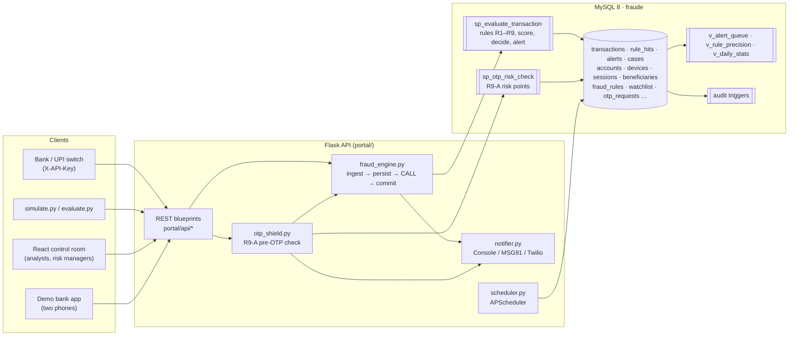
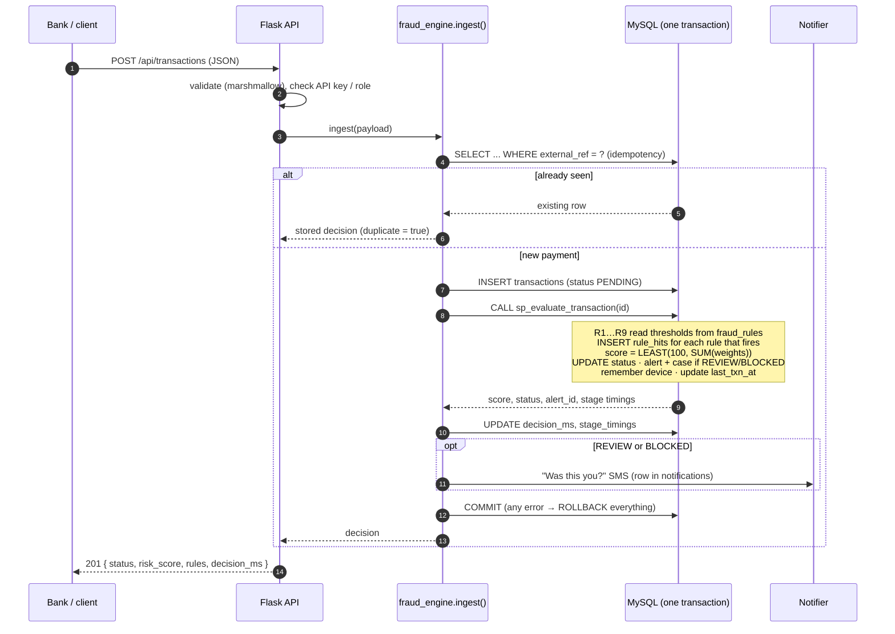
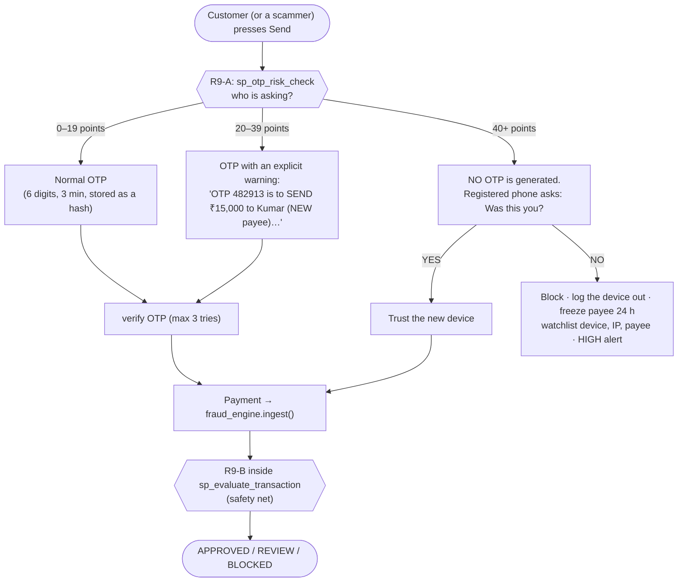
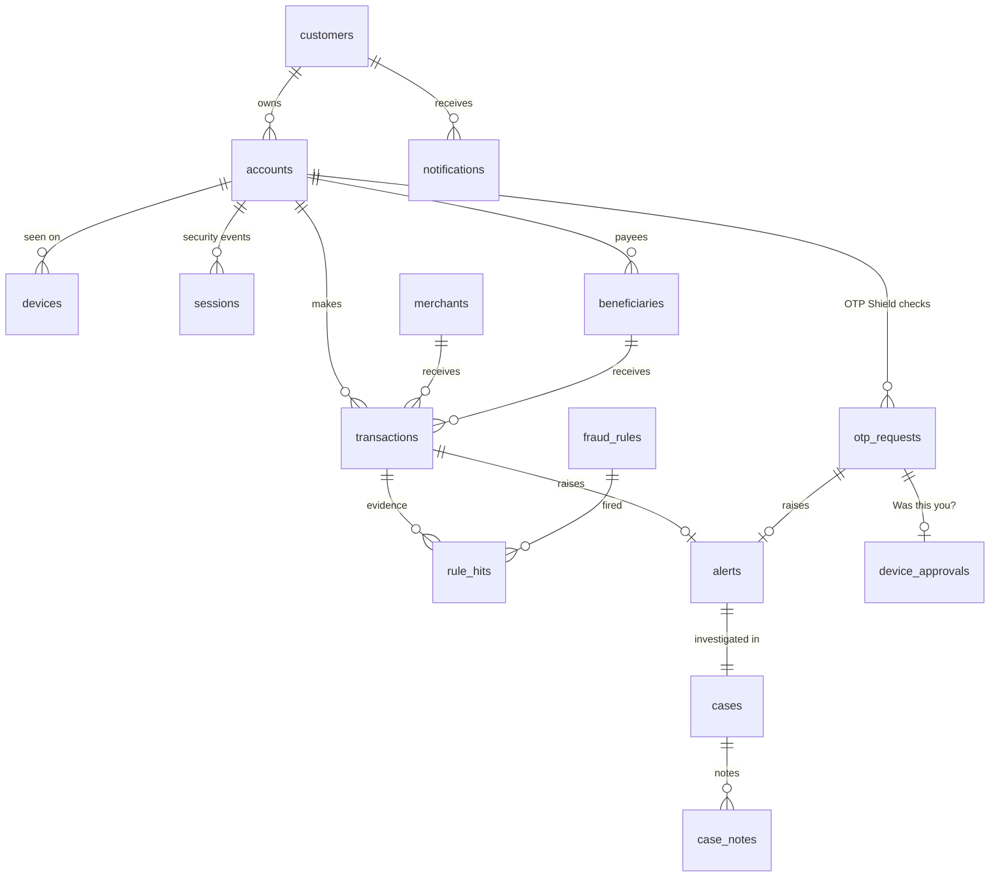

# FraudShield architecture

## The big picture

**Python orchestrates, MySQL decides.** The nine rules, the score, the decision, the alert and
case creation all happen inside `sp_evaluate_transaction`. Python never re-implements a rule.

## One payment, step by step

Because the INSERT, the procedure and the notification share one database transaction, a payment
can never exist without its decision and evidence (`tests/test_ingest_atomicity.py` proves the
rollback). Deadlocks between parallel payments of one account are retried up to three times.

## OTP Shield: two checkpoints

## Code layout

| Layer | Where | Responsibility |
|---|---|---|
| SQL engine | `portal/sql/*.sql` | indexes, views, audit triggers, `sp_evaluate_transaction`, `sp_otp_risk_check`, `fn_inr` |
| Loader | `helpers/db_helpers.py` | runs the SQL files, honouring `DELIMITER` (also called from the Alembic migration) |
| Services | `portal/services/` | `fraud_engine`, `otp_shield`, `notifier`, `simulator`, `evaluator` |
| API | `portal/api/` | thin blueprints: validate → call a service → `ok()` / `error()` |
| Models | `portal/models/` | SQLAlchemy tables (schema source for Flask-Migrate) |
| Jobs | `portal/scheduler.py` | expire OTPs (1 min), refresh `daily_stats` (5 min), nightly dormant marking |
| UI | `frontend/src/` | React 18 + Vite + Tailwind + Framer Motion + Recharts |

## Data model (main tables)

## Performance design

* Every rule reads one account's recent history, so the indexes start with `account_id` and end
  with a time column (`ix_txn_account_time`, `ix_sessions_account_event_time`, ...).
* The watchlist check is an index lookup on `(entry_type, entry_value)`.
* Only the evaluated row is locked (`SELECT ... FOR UPDATE OF t`), so payments of different
  accounts never wait for each other.
* Measured on a laptop: ~15 ms median, ~30 ms p95 per decision (`tests/test_performance.py`);
  see `docs/RULES.md` for the full evaluation results.

## Security

* bcrypt password hashes; JWT access (15 min) + refresh (7 days); logout revokes both
  (`token_blocklist`).
* Role checks on every staff endpoint (`min_role`), enforced on the server even though the UI also
  hides what a role cannot do. Demo-bank tokens are a separate kind and never pass a staff check.
* All SQL is parameterised; the only identifiers formatted into SQL (procedure and database names)
  are validated against a strict pattern first.
* Rate limits: login 10/min, OTP requests 5 per account per 10 min, 3 OTP attempts.
* CORS only for `FRONTEND_ORIGIN`. Errors return a generic message; details go to `logs/app.log`
  with the request ID that is also returned in the `X-Request-ID` header.
